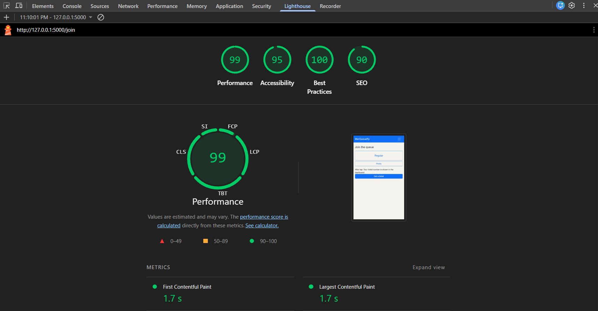
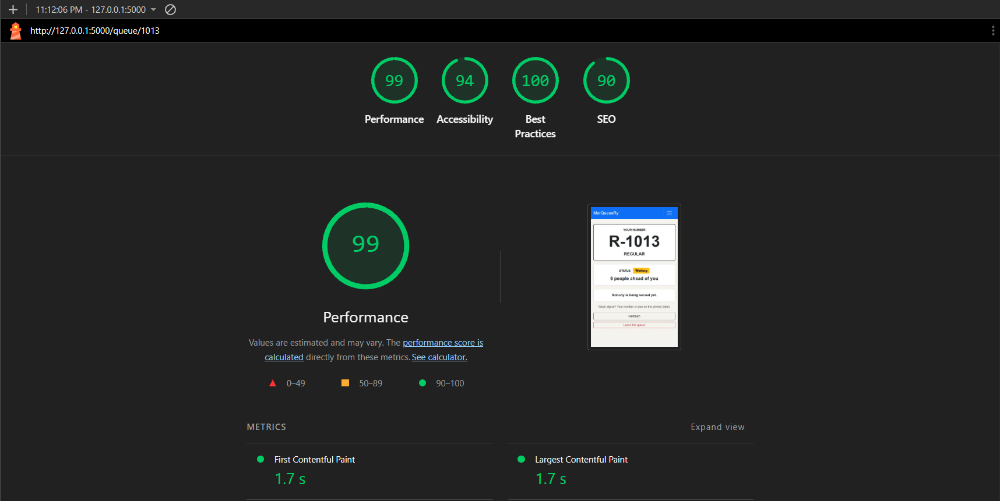
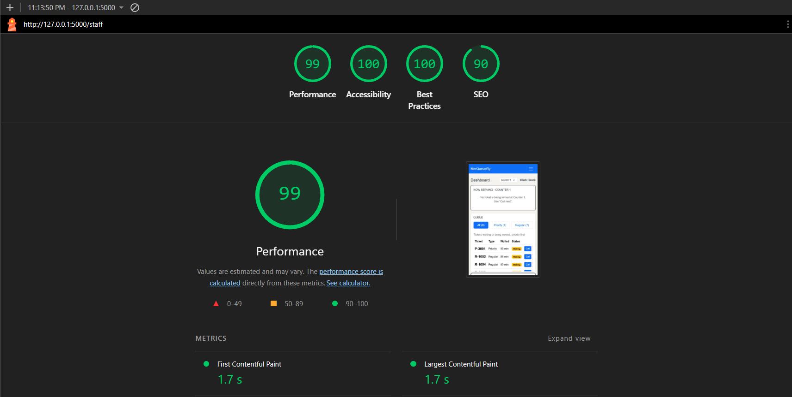
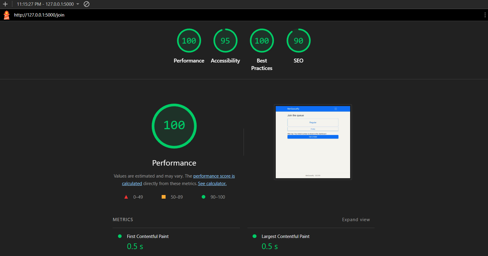
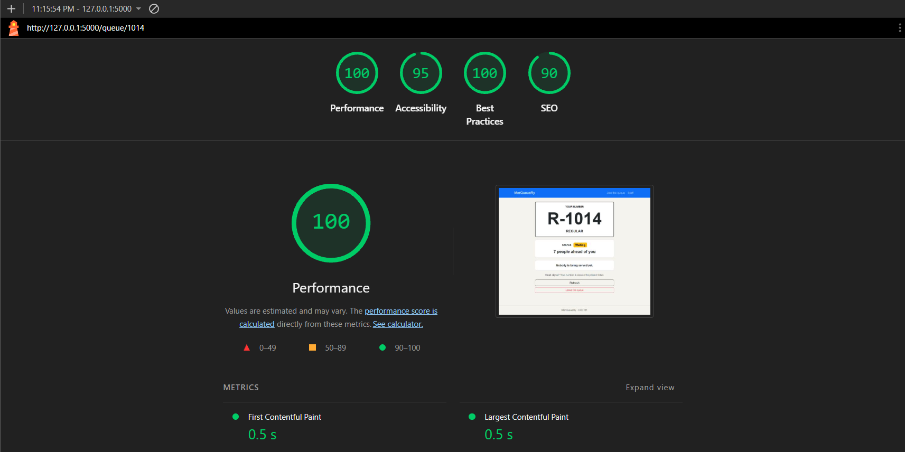

## Accessibility check
---

**9a. Lighthouse.**

| Phone | Screenshot |
| Join |  |
| My Place |  |
| Dashboard |  |

| Laptop | Screenshot |
| Join |  |
| My Place |  |
| Dashboard |  |

---

**9b. Keyboard only.**

- Can you see where the focus is at every step? 
Yes, I can see everytime i press a key (Tab, Shift+Tab, Enter, Space and the arrow keys) in my keyboard. 

- Can you reach and use every control?
Yes, I tested every keys and they work perfectly.

- Does the skip link appear on the first Tab?
Yes, it says "Skip to the main content".

---

**9c. Manual Checklist.**

| Check | Join | My place | Staff |
| --- | --- | --- | --- |
| Every input has a visible label | ✅ | ✅ | ✅ |
| Error messages say what to do, in text | ✅ | ✅ | ✅ |
| Status is shown in words, not only color | ✅ | ✅ | ✅ |
| Text and buttons are readable at 375 px with no sideways page scroll | ✅ | ✅ | ❌ (adjusted the table size size) |
| Buttons are at least about 44 × 44 px on a phone | ✅ | ✅ | ✅ |
| Page has one `<h1>` and headings in order | ✅ | ❌ (I put a header to the screen) | ✅ |
| `<html lang="en">` (or your language) is set | ✅ | ✅ | ✅ |