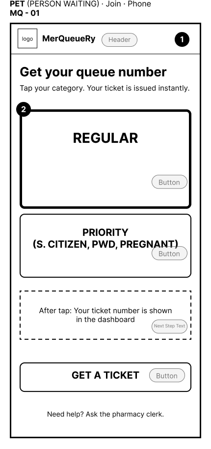
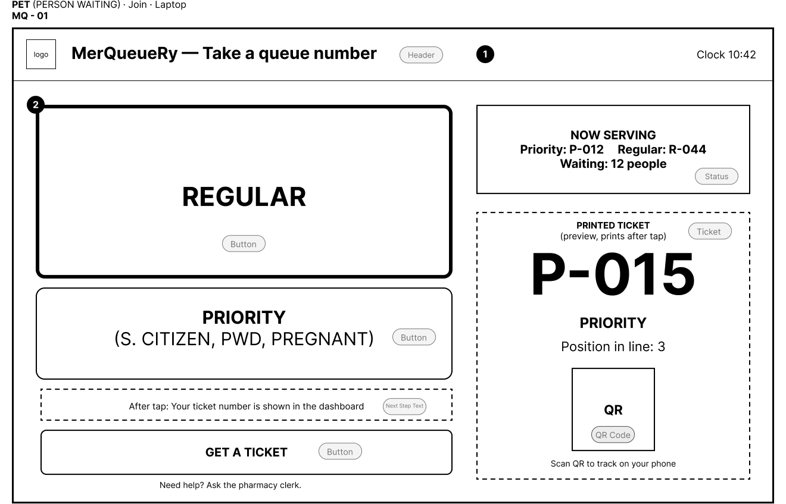
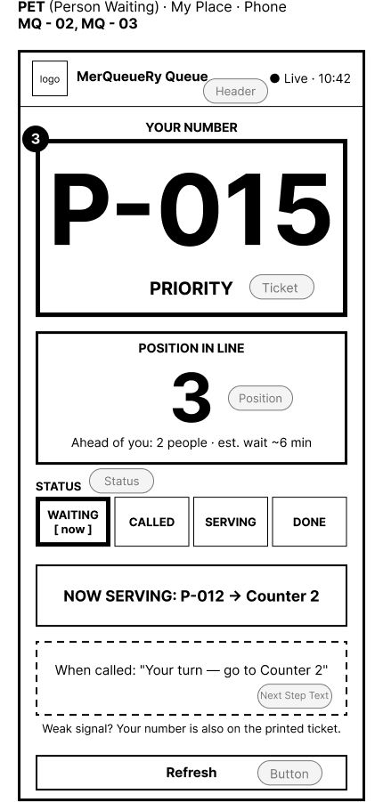
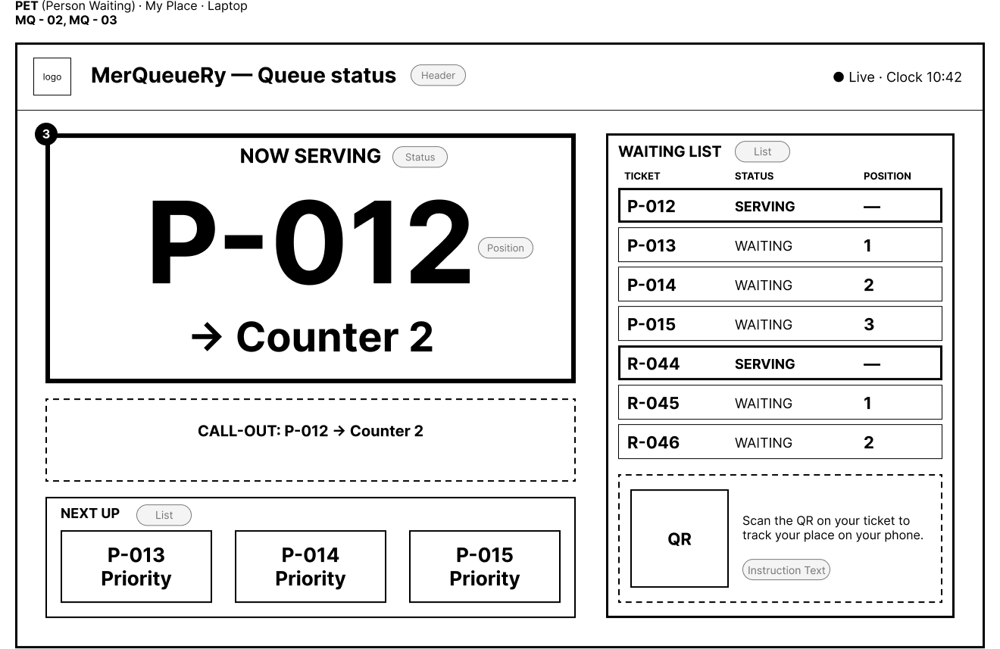
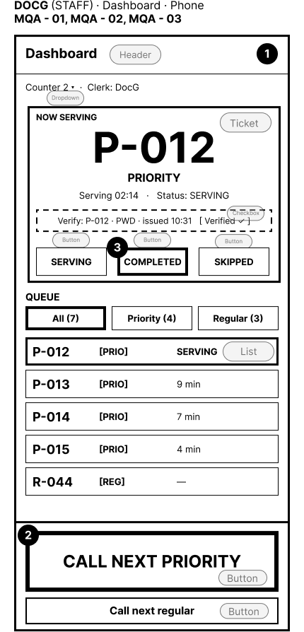
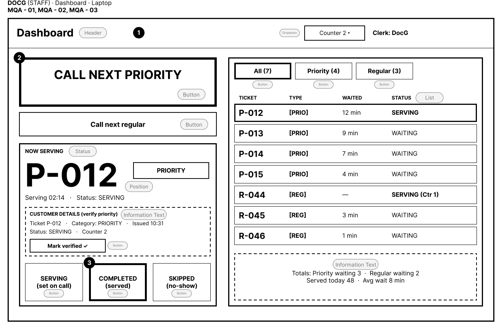
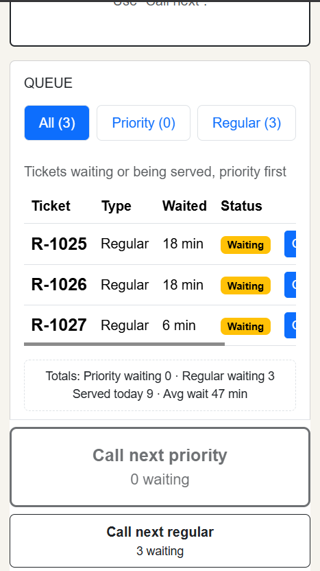
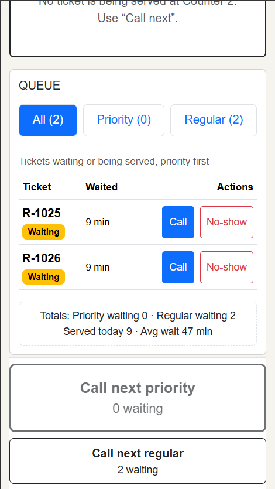

# REPORT

## 1. Title details
| | |
| --- | --- |
| **App name** | MerQueueRy |
| **Setting** | Pharmacy counter where customers buy medicine |
| **Full name** | Joshua Khent G. Kenezo |
| **Student ID** | 2023-2491 |
| **Section** | CS3B |
| **Date** | October 25, 2026 |
| **Pull request** | https://github.com/sadcattoo/ccc181/pull/2#issue-6029387730 |

## 2. Personas

Read the full persona here [personas.md](personas.md) 

**Pet, PWD Customer**
- Quote: "Daghan kaayog tawo sa mercury ganina nya nahutdan og number..."
- Top tasks: Call the next priority/regular customer [MQ-01]

**DocG, Pharmacy Clerk**
- Quote: "Wala na ko kabalo kinsa akong unahon kay daghan kaayo sila especially gabii..."
- Top tasks: Select PWD priority category to get a ticket [MQA-01]

## 3. Screens

Join (phone): Used by Pet. The first thing Pet sees when getting a ticket. [MQ-01]

Join (laptop): Used by Pet. The first thing Pet sees when getting a ticket. [MQ-01]

My place (phone): Used by Pet. After getting the ticket, she scan the QR code in the ticket. [MQ-02]

My place (laptop): Used by Pet. After getting the ticket, she is currently watching for her ticket to be called in My place. [MQ-02]

Dashboard (phone): Used by DocG. She is currently managing customers. [MQA-01], [MQA-02], [MQA-03]

Dashboard (laptop): Used by DocG. She is currently managing customers. [MQA-01], [MQA-02], [MQA-03]

## 4. Design decisions

- First, the decision I made was to make a big button for the priority, but thinking that it might be abused, I placed it below the regular one and made the regular one bigger. Second, I made this system specifically for the Mercury Drug Store Tibanga branch because I personally experienced how bad and outdated their manual queuing is. Third, I designed my wireframes to be age-friendly so it will be easy for them to use the system, as they are the common customers of a pharmacy.

## 5. Self-review

Source: [feedback.md](feedback.md)
 
| Problem found in my wireframes | What I changed |
|---|---|
| Anyone can tap PWD / Priority, and there’s no way to undo it. A wrong tap prints a priority ticket in the wrong queue (error prevention). | Instead of just doing one tap in the category button, i will put another button to proceed in the next part so they can change if they mistouch the priority button. Also, I will put the priority button below the regular button to lessen the human error. Even though the cashier can check the category. |

## 6. Accessibility

**Lighthouse scores (mobile):**
 
| Page | Performance | Accessibility | Best Practices | SEO |
|---|---|---|---|---|
| Join the queue | 99 | 95 | 100 | 90 |
| My place | 99 | 94 | 100 | 90 |
| Staff dashboard | 99 | 100 | 100 | 90 |

**Lighthouse scores (laptop):**
 
| Page | Performance | Accessibility | Best Practices | SEO |
|---|---|---|---|---|
| Join the queue | 100 | 95 | 100 | 90 |
| My place | 100 | 95 | 100 | 90 |
| Staff dashboard | 100 | 100 | 100| 90 |

**Most important issue you fixed:** I fixed the sideways scroll bar when the interface is at 375px.

## 7. Usability test

Tester: Muammar, BSCE 3
 
| Task | Result (done / needed help / failed) | Time or notes |
|---|---|---|
| Join the queue as Priority | Done | 15 seconds. He easily got a ticket  |
| Find your position in line | Done| 10 seconds. He easily saw his position as well as his ticket number.  |
| Call the next ticket (staff) | Done | 25 seconds. He wandered through the screen first, then did the task. |

**One improvement I made:**
 
- I fix the sideways scroll bar when the dashboard is at 375px. Also, the tester found out that the order sometimes is wrong, especially the order list, and doesn't follow first come, first serve. But after I reviewed the system, It works perfectly fine. I explained to the tester that the ticket he saw is just a random ticket number that I put earlier that is why it is not accomodated first. 

## 8. Reflection: what was hardest this week, and what you will change in your interface when the data moves to a database in Week 4
- I think the Part 8 would be the hardest this week. The major changes in my interface when the data moves to a database would be integration of QR Code into the system.

## 9. Declaration: any AI tools or outside sources you used and what for. Write "None" if you used none.
I used Claude to help me finished this week's activity. I used it to correct my grammar, teach me how to solve errors, and show me what causes the bugs and errors.
