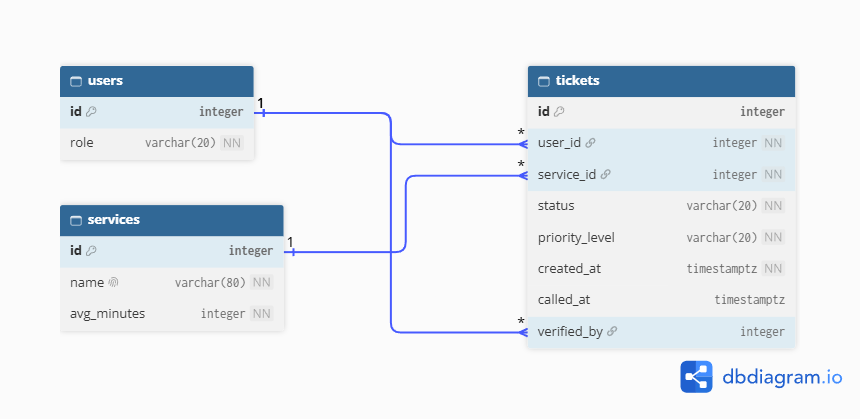

# MerQueueRy Schema

## Requirement nouns

| Req ID | Requirement | Nouns | Table or column? |
| --- | --- | --- | --- |
| MQ-01 | A **senior citizen** or **person with a disability** can join a **priority lane** that is served first. | senior citizen, person with a disability, priority lane | users *(the person)*, tickets.priority_level (`pwd`) |
| MQ-02 | A **customer** can join the **queue** for a **service** by tapping a **button**. | customer, queue, service, button | users, *(not a table)*, services, *(UI, not stored)* |
| MQ-04 | A customer can see their **ticket number**, **status**, and how many people are **ahead** of them. | ticket number, status, ahead | tickets.id, tickets.status, *(computed)* |
| MQ-05 | A customer can receive **audio chime** and **high-contrast screen call out**. *(Could, later)* | audio chime, high-contrast screen call out | *(triggered when tickets.status becomes `called`; no new column)* |
| MQ-06 | A customer can **leave** the queue before being **called**. | leave, called | tickets.status (`left`), tickets.called_at |
| MQ-07 | A **clerk/staff member** can **call** the next **waiting ticket** for a service. | clerk/staff member, waiting ticket, service | users.role, tickets.status (`waiting` → `called`), services |
| MQ-08 | A clerk/staff member can mark a called **ticket** as **served**, **completed**, or **no-show**. | ticket, served, completed, no-show | tickets, tickets.status (`served`, `completed`, `no_show`) |
| MQ-09 | A clerk/staff member can **verify** **PWD/priority ticket** **details** and **status**. | PWD/priority ticket, details, status, verify | tickets, tickets.priority_level, tickets.status, tickets.verified_by, tickets.verified_at |
| MQ-10 | A clerk/staff can manually **adjust or override** a ticket's **priority level** upon physically verifying a customer's **ID** at the counter. | priority level, ID, override | tickets.priority_level, tickets.verified_by, tickets.verified_at *(ID is checked in person, not stored)* |
| MQ-11 | A clerk/staff can **export** end-of-day queue performance **metrics** (**average wait time**, **total served**, **priority ratio**, **total skipped**) to **CSV/PDF**. | metrics, average wait time, total served, priority ratio, total skipped | *(all computed)* from tickets.created_at, called_at, status, priority_level |

## Tables and Columns

| Table | Columns |
| --- | --- |
| `users` | id, role |
| `services` | id, name, avg_minutes |
| `tickets` | id, user_id, service_id, status, priority_level, created_at, called_at, verified_by, verified_at |

## Types and Constraints

| Table | Column | PostgreSQL type | Constraint | Why |
| --- | --- | --- | --- | --- |
| users | id | integer, generated | PRIMARY KEY | Generated by the database, never reused |
| users | role | varchar(20) | NOT NULL, CHECK (role IN ('customer', 'clerk')) | Only the two roles the requirements use |
| services | id | integer, generated | PRIMARY KEY | Generated by the database, never reused |
| services | name | varchar(80) | NOT NULL UNIQUE | No two services with the same name |
| services | avg_minutes | integer | NOT NULL, CHECK (avg_minutes > 0) | Rejects impossible values |
| tickets | id | integer, generated | PRIMARY KEY | Used as the ticket number; generated, never reused |
| tickets | user_id | integer | NOT NULL REFERENCES users(id) | No ticket for a missing customer |
| tickets | service_id | integer | NOT NULL REFERENCES services(id) | No ticket for a missing service |
| tickets | status | varchar(20) | NOT NULL DEFAULT 'waiting', CHECK (status IN ('waiting', 'called', 'served', 'completed', 'no_show', 'left')) | Only the states MQ-06 and MQ-08 describe |
| tickets | priority_level | varchar(20) | NOT NULL DEFAULT 'regular', CHECK (priority_level IN ('regular', 'pwd')) | Only the two customer types; `pwd` uses the priority lane; a clerk can override it (MQ-10) |
| tickets | created_at | timestamptz | NOT NULL DEFAULT now() | Time zone safe; set by the database; used for ordering and wait time |
| tickets | called_at | timestamptz | CHECK (called_at IS NULL OR called_at >= created_at) | Empty until called; cannot be before the ticket was created |
| tickets | verified_by | integer | REFERENCES users(id) | Empty until a clerk verifies; must be a real user |
| tickets | verified_at | timestamptz | none (NULL until verified) | Time zone safe; when the clerk verified the ID |

## ERD

###Deleting rules:
-RESTRICT: deleting a user must not delete their tickets, because end-of-day metrics (MQ-11) are computed from past tickets.
SET NULL is not possible here because user_id is NOT NULL.
Ref: tickets.user_id > users.id [delete: restrict]

-RESTRICT: deleting a service must not delete its old tickets, because they are needed for reports (MQ-11).
SET NULL is not possible here because service_id is NOT NULL.
Ref: tickets.service_id > services.id [delete: restrict]

-RESTRICT: verified_by records which clerk checked the ID for a priority ticket (MQ-09, MQ-10). Deleting that clerk must not erase the record or the tickets, so the delete is blocked.
Ref: tickets.verified_by > users.id [delete: restrict]

## Check that it is normalized

1. One value per cell (1NF): does any column hold a list, such as "Haircut, Shave"?
- No column holds a list. Each one holds a single value, such as one status, one role or one timestamp.

2. Depends on the whole key (2NF): in each join table, does every extra column depend on both keys?
- Not applicable, because the schema has no join tables. Every table has a single-column primary key, so no column can depend on only part of a key.

3. No hidden copies (3NF): would you ever have to update the same fact, such as a person's email or a service's name, in more than one row?
- No fact is stored in more than one row. A service’s name lives only in services, and tickets stores just service_id. A user’s role lives only in users. Queue position, average wait time and the other metrics are computed, not stored.
